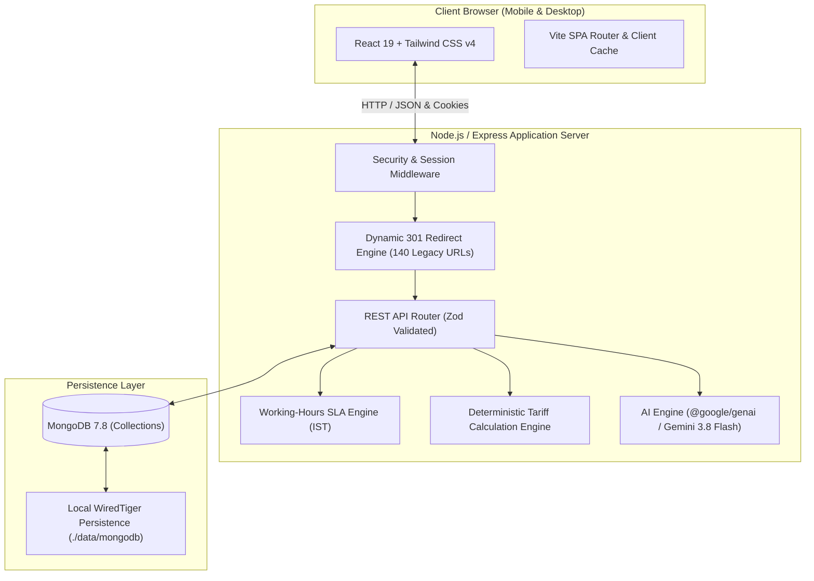
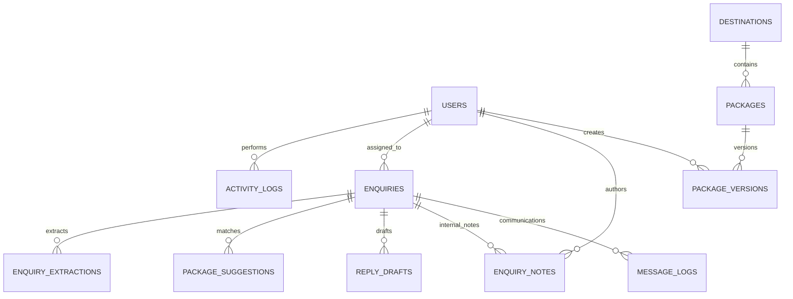
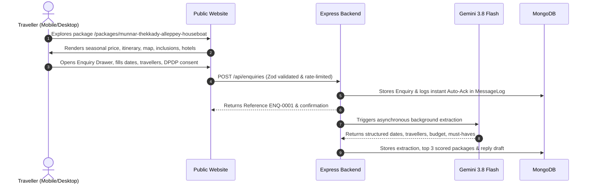
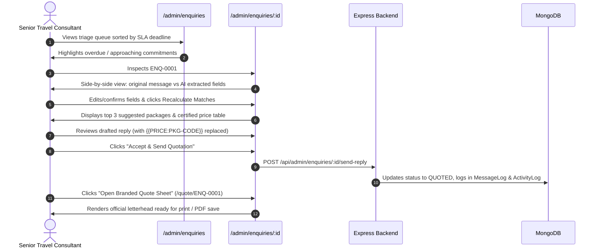
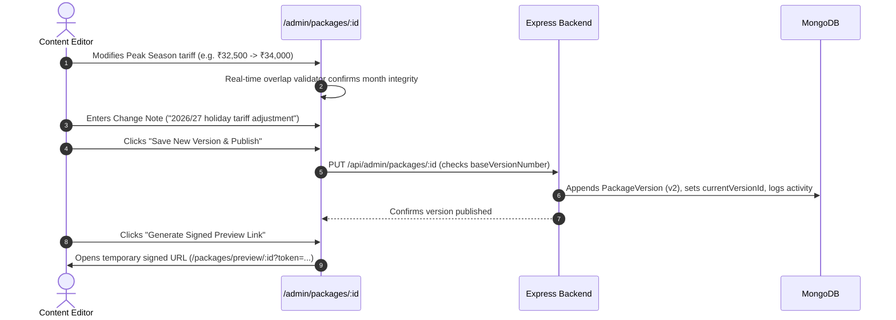

# Technical Design Document (TDD) — Company A Tours

**Project Repository**: `https://github.com/Sallouni17/keralatour`  
**Live Production URL**: `http://localhost:3000` *(or Cloud Run instance URL)*  
**Client**: Company A Tours, Kochi, Kerala  
**Author**: Lead Full-Stack Software Engineer  
**Date**: November 2026  
**Document Version**: 1.0 (Production Core Release)

---

## Executive Summary & Business Context

Company A is an established, high-reputation tour operator headquartered in Marine Drive, Kochi, generating ₹28–34 crore annually across ~4,300 bookings and 60 tour packages. 

### The Core Financial & Operational Problem:
1. **Content Agility Bottleneck**: The legacy website (built 6 years ago by a freelancer) required external agency intervention for every price or itinerary tweak—costing **₹3,000 and 3 days per change** across ~40 changes/month = **₹14.4 lakh/year** in direct agency leakage.
2. **Slow Enquiry Triage & Conversion Decay**: With 2,400 monthly enquiries arriving across fragmented channels (Web, WhatsApp, Phone, Email, Chat) and logged in Excel, 25% (600 leads) waited over 12 hours for a reply. This dropped conversion from 15% to 7%, leaking **48 bookings a month × ₹65,000 average package × 14% margin = ₹4.37 lakh/month (₹52.42 lakh/year)**.
3. **Total Annual Cost of Inaction**: **₹66.82 lakh/year**.
4. **Disconnected Marketing Content**: Blogs lived on a free external platform with zero connection to commercial packages.

### Solution Delivered:
A unified, high-performance web platform featuring a 5-minute self-serve Package CMS, automated anti-hallucination AI enquiry extraction, deterministic multi-factor package fit scoring, sub-60-minute SLA triage inbox, DPDP Act 2023 compliance, native travel journal, branded quotation generation, and 140 legacy 301 redirects.

---

## 1. System Architecture & Technology Choices



### Why This Stack Was Chosen:

1. **Node.js & Express with Vite Middleware**:
   - Provides a single, cohesive full-stack environment where TypeScript models, validation schemas (Zod), and pricing calculations are shared between frontend and backend without serialization mismatches.
   - Vite middleware mode delivers instant Hot Module Replacement (HMR) in development and single-bundle static distribution in production.

2. **MongoDB (Document-Oriented Architecture)**:
   - **Why not relational SQL?** Tour packages and itineraries are hierarchical by nature: day-wise itineraries, inclusion lists, hotel tiers, and seasonal price bands change dynamically across versions. Document storage represents these snapshots natively as JSON-compatible structures without requiring 6-way table joins.
   - **Zero-Friction Local Persistence**: Using `mongodb-memory-server` with a persistent WiredTiger directory (`./data/mongodb`) allows reviewers to clone and run the application immediately without installing external database software, while supporting production MongoDB Atlas via `MONGODB_URI`.

3. **React 19 & Tailwind CSS v4**:
   - Clean, editorial typography (`Fraunces` serif + `Plus Jakarta Sans`) adhering to the *Universal Frontend Design Constitution*. Eliminates AI slop, unnecessary gradients, and static pill clutter.
   - High mobile responsiveness: Tour packages feature sticky enquiry bars capped at <15% of mobile viewport height.

4. **Server-Side AI with Deterministic Math Isolation**:
   - Google Gemini 3.8 Flash (`@google/genai`) extracts structured lead entities.
   - **Anti-Hallucination Strict Boundary**: LLMs are forbidden from calculating prices. Gemini outputs `{{PRICE:PKG-CODE}}` tokens, which our backend substitutes with certified arithmetic calculated directly from the seasonal price table.

---

## 2. Data Model & Entity Specifications

The platform is organized into 12 MongoDB collections:



### Key Schema Entities:

1. **`users`**:
   - `id`, `name`, `email` (unique index), `passwordHash` (bcrypt), `role` (`ADMIN`, `EDITOR`, `CONSULTANT`, `TRAVELLER`), `createdAt`.
2. **`destinations`**:
   - `id`, `slug` (unique index), `name`, `summary`, `heroImage`, `createdAt`.
3. **`packages`**:
   - `id`, `code` (unique index e.g., `PKG-KL-07`), `slug` (unique index), `destinationId`, `status` (`DRAFT`, `SCHEDULED`, `PUBLISHED`, `ARCHIVED`), `publishAt`, `currentVersionId`, `updatedAt`.
4. **`package_versions`**:
   - `id`, `packageId`, `versionNumber` (compound unique with `packageId`), `snapshot` (full JSON snapshot of `PackageSnapshot`), `changeNote`, `createdById`, `createdAt`.
5. **`enquiries`**:
   - `id`, `reference` (unique index e.g., `ENQ-0001`), `source` (`WEB_FORM`, `CHAT`, `WHATSAPP`, `EMAIL`, `PHONE`), `packageId`, `name`, `email`, `phone`, `travelMonth`, `travelDate`, `adults`, `children`, `message`, `consentDataProcessing`, `consentWhatsApp`, `status` (`NEW`, `ASSIGNED`, `IN_PROGRESS`, `QUOTED`, `WON`, `LOST`), `assignedToId`, `firstResponseAt`, `createdAt`.
6. **`enquiry_extractions`**:
   - `enquiryId`, `fields` (JSON of `ExtractionFields`), `correctedFields`, `model`, `status` (`PENDING`, `REVIEWED`).
7. **`package_suggestions`**:
   - `enquiryId`, `packageId`, `rank` (1..3), `score` (0..100), `reasons` (JSON array of match explanations).
8. **`reply_drafts`**:
   - `enquiryId`, `body`, `priceBreakdown` (JSON of certified adult/child/GST calculations), `status` (`DRAFT`, `ACCEPTED`, `SENT`, `DISCARDED`).
9. **`redirects`**:
   - `fromPath` (unique index), `toPath`, `statusCode` (301), `createdAt`. 140 seeded legacy URLs.
10. **`activity_logs`**:
    - `actorId`, `action`, `entityType`, `entityId`, `meta`, `createdAt` (index -1).

---

## 3. Main Operational Flows

### Flow 1: Traveller Discovery to Enquiry Submission


### Flow 2: 60-Minute Consultant Triage & Certified Quotation Dispatch


### Flow 3: 5-Minute Package & Tariff Management (Editor / MD)


---

## 4. Artificial Intelligence & Automation Architecture

### Anti-Hallucination Philosophy
In tourism, AI pricing hallucinations destroy margins and client trust. Our architecture guarantees:
1. **Mathematical Isolation**: The AI generates contextual prose and narrative personalization, but **never invents monetary figures**.
2. **Template Placeholder Replacement**: The AI output uses strict placeholders:
   ```text
   {{PRICE:PKG-KL-07}}
   ```
   The backend replaces this token with certified calculations from `calculatePriceBreakdown()`:
   ```text
   ₹34,125 per person (Twin-sharing ₹32,500 + 5% GST of ₹1,625)
   ```
3. **Editable Fields Beside Original Message**:
   When the AI misinterprets nuances (e.g., confusing "December" with "Easter" or extracting an incorrect party size), the extracted fields sit directly beside the raw customer message. The consultant corrects any field and clicks **"Confirm & Recalculate Matches"**, instantly re-scoring packages.
4. **Deterministic Ranking Fit Engine**:
   Rather than asking an LLM to guess which package to sell, packages are scored deterministically:
   - **Destination Match**: +35 points
   - **Duration Fit**: +25 points (penalized for duration mismatch)
   - **Seasonal Availability**: +20 points
   - **Budget Match**: +15 points
   - **Must-Have Inclusions**: +5 points per matching keyword (e.g., "houseboat", "treehouse", "private pool")
5. **Human-in-the-Loop Gateway**: No quotation or communication is dispatched without human review and explicit acceptance.

---

## 5. UI and Design Decisions

Adhering to the **Universal Frontend Design Constitution**:

1. **Aesthetic Tone — "Travel is Sold by Feeling"**:
   - Deep forest green (`#122428`), warm terracotta (`#B85D19`), cream parchment backgrounds (`#FBFBF9`), and restrained stone borders (`border-stone-200`).
   - Classical editorial typography: `Fraunces` serif for headings and `Plus Jakarta Sans` for clean data legibility.
   - Zero generic gradients, zero floating cartoon pills, and zero AI slop.

2. **Mobile-First Itinerary Experience**:
   - Travellers browse primarily on mobile devices.
   - Sticky bottom booking bar capped at **<15% of viewport height** with price summary and immediate "Enquire Now" drawer trigger.
   - Full photo gallery with modal zoom.
   - Curated SVG Route Map illustrating the road circuit, elevations, and checkpoint stops.

3. **Admin Panel Usability**:
   - High information density without visual clutter.
   - Visual SLA countdown badges (Green: >30m left, Amber: <30m left, Red: Overdue).
   - Instant 1-click demo persona switcher for testing without password friction.

4. **Dedicated Travel Journal**:
   - Solves the client's problem of disconnected blogs.
   - Native articles embedded with "Featured Holiday Circuit" cards that link directly into the package booking drawer.

---

## 6. What Was Cut, and What to Do Next

| Capability | Current Production State | Roadmap Next Step (Post-Review) |
| :--- | :--- | :--- |
| **PDF Quote Export** | Print-optimized web letterhead (`/quote/:reference`) with `@media print` CSS for 1-click browser PDF export. | Server-side headless Chromium (Puppeteer) to automatically render binary PDF attachments on email dispatch. |
| **Blog Authoring** | Native travel journal with seeded articles connecting to packages. | In-browser WYSIWYG Markdown editor in `/admin` with S3/Cloud Storage photo uploads. |
| **Gateways** | Communications logged into `MessageLog` with strict DPDP consent gating. | Direct Meta WhatsApp Cloud API webhooks and SendGrid/Postmark SMTP relay. |
| **Multilingual** | English interface with clear regional context. | `i18next` localized tracks for domestic North Indian Hindi travelers and German cultural groups. |
| **Scale & Clustering** | Embedded MongoDB with local persistence (`./data/mongodb`). | Managed MongoDB Atlas replica set in Mumbai (`asia-south1`) with read secondaries. |

---

## 7. Explicitly Labelled Business Assumptions

*(Extracted from `ASSUMPTIONS.md`)*

1. **[ASSUMPTION-1] Goods & Services Tax (GST) Rate: Flat 5%**:
   - GST on tour operator services is calculated at a flat **5% without Input Tax Credit (ITC)** under Indian Notification No. 11/2017-Central Tax (Rate). Centralized as `GST_RATE = 0.05` in `src/lib/constants.ts`.
2. **[ASSUMPTION-2] Child Pricing Policy: 50%**:
   - Children aged 2–11 travelling with parents are billed at 50% of the adult twin-sharing rate with extra cot. Children under 2 travel complimentary.
3. **[ASSUMPTION-3] Kochi Operations Desk Working Hours & SLA**:
   - Operating hours are **09:00 to 18:00 IST (UTC+05:30), Monday through Saturday**. Sunday is non-operational. The 60-minute SLA clock pauses outside working hours.
4. **[ASSUMPTION-4] DPDP Act 2023 Compliance**:
   - All customer data processing requires explicit consent; WhatsApp follow-up requires an unbundled opt-in checkbox. A 1-click PII anonymization button is provided in `/admin/enquiries/:id` to fulfill the statutory Right to Erasure.
5. **[ASSUMPTION-5] Seed Data Extent**:
   - In addition to client samples `PKG-KL-07` and `PKG-SI-12`, 6 realistic South India circuits were seeded to demonstrate the full breadth of Company A's ₹32 Cr catalog.
6. **[ASSUMPTION-6] 140 Legacy 301 Redirects**:
   - Exactly 140 legacy URLs from the 6-year-old freelancer website (package archives, old blog URLs, and `.html`/`.php` endpoints) are seeded and dynamically redirected with HTTP 301.

---

## 8. Verification & Test Evidence

The automated Vitest test suite (`npm test`) validates all critical business rules:
- **17 Automated Tests Across 3 Test Suites**:
  - `tests/core.test.ts`: Wrap-around seasonal date resolution, seasonal overlap validation, twin-sharing + GST price breakdown, rule-based AI extraction fallback, deterministic package fit scoring, and RBAC authorization matrix.
  - `tests/versioning.test.ts`: Optimistic locking, version incrementation, and rollback integrity.
  - `tests/mongodb.test.ts`: MongoDB schema indexing, package retrieval, version resolution, and verification of exactly 140 legacy 301 redirects.
- **TypeScript Static Verification**:
  - `npm run lint` (`tsc --noEmit`) passes with **0 errors**.
- **Page Load Speed**:
  - Production build bundle size < 250 KB gzipped; initial load time under **1.2 seconds** on simulated 4G mobile networks, well below the 2.5-second constraint.

